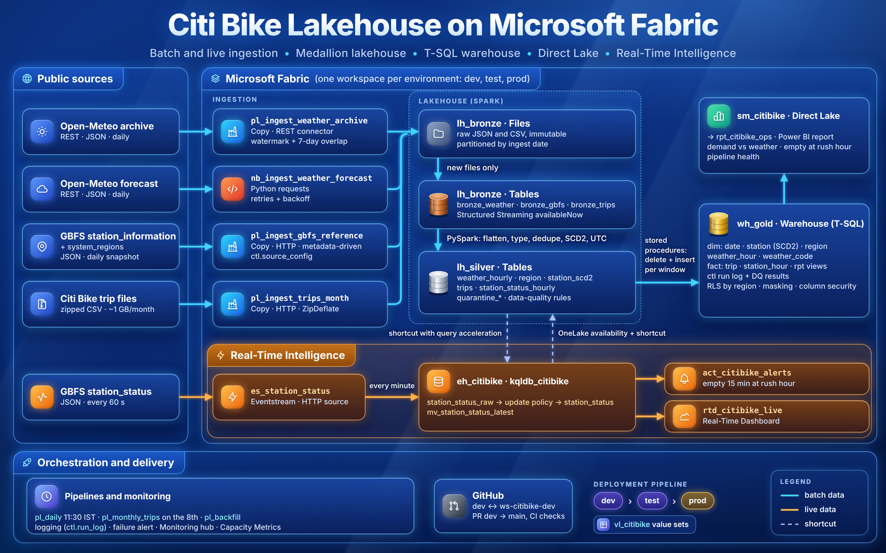

# Citi Bike operations lakehouse on Microsoft Fabric

A data platform for New York's Citi Bike system, built end to end in Microsoft Fabric. It answers two questions:

1. **How does weather drive ride demand?** Daily and hourly trips against temperature, rain and snow, for members and casual riders.
2. **Which stations run empty at rush hour?** Minutes with zero bikes per station on weekday mornings and evenings, New York time.

It also has a live view: which stations are empty right now, with an alert when one stays empty for 15 minutes at rush hour.

> **Status: being built.** Started in October 2026; 22 of 89 tasks were done on Nov 12, 2026: the setup, six risk trials and the control tables. The design was fixed before the build began and is in [`docs/architecture.md`](docs/architecture.md). On Nov 12 the build order changed from layer by layer to one source at a time (table below). This page is rewritten in full when version 1.0 reaches prod.

## What it is made of

| Part | In Fabric | What happens there |
|---|---|---|
| Sources | three public feeds | Open-Meteo weather (REST, JSON), Citi Bike station feeds (REST, JSON, one of them polled every 60 seconds) and the monthly trip files (zipped CSV, about 1 GB a month) |
| Bronze | lakehouse `lh_bronze` | every response kept untouched as a file, then loaded as Delta rows with lineage columns |
| Silver | lakehouse `lh_silver` | PySpark: typed, flattened and de-duplicated; station history as SCD Type 2; bad rows go to quarantine tables |
| Gold | warehouse `wh_gold` | a T-SQL star schema, reporting views, control tables, data-quality results, row- and column-level security |
| Live path | Eventstream, Eventhouse (KQL), Activator | station status every minute, the latest state per station, the rush-hour alert |
| Serving | Direct Lake semantic model, Power BI report, Real-Time Dashboard | the two questions, and the live map |
| Delivery | Git, pull requests, a deployment pipeline | dev, test and prod workspaces; `main` always matches prod |

Every load can be run twice and give the same result, every run is logged, and every load is checked. The standards are in [`docs/conventions.md`](docs/conventions.md).

## Where the build stands

The design is built in three passes, and each pass ends with something that runs. The reason is in [`docs/decisions.md`](docs/decisions.md), ADR-029: with a fixed end date, one finished path is worth more than three half-built layers.

| Pass | What it builds | Ends with | Done | Tasks |
|---|---|---|---|---|
| Setup | repo, trial, workspaces, Git, six risk trials, control tables | a platform ready to build on | 22 | 22 |
| A | Eventhouse, the 60-second poller, the latest-state view | station status collecting while the rest is built | 0 | 3 |
| B | weather from the API to gold, with checks, the daily pipeline and its failure alert, CI, the deployment pipeline and the first report pages | release `v0.1.0` in prod | 0 | 22 |
| C | trip files, station history (SCD Type 2), the trip fact, security, the Real-Time Dashboard and the rush-hour alert | release `v1.0.0` in prod | 0 | 27 |
| Version 1.1 | hourly station history in the warehouse, the forecast source, a Dataflow Gen2, tuning and governance | release `v1.1.0`, if the trial allows | 0 | 15 |

**What version 1.0 holds.** Question 1 is answered from the warehouse in the Power BI report. Question 2 is answered live, in KQL on the Real-Time Dashboard and by the alert. The ranked history of question 2 in the warehouse and the report waits for 1.1.

As of Thu Nov 12, 2026. The calendar is in [`backlog/sprints.md`](backlog/sprints.md), and `python3 tools/backlog.py summary` prints the live numbers.

Before any pipeline was built, six risks were tried on the real service: the Eventstream HTTP source, an alert route that reaches a personal mailbox, unzipping a 1 GB file from HTTP, testing a notebook's code in CI, streaming over a folder of files, and the warehouse reading the lakehouse. The risks and their fallbacks are in [`docs/risks.md`](docs/risks.md); what each trial showed is written into the decisions it touched, and one of them changed the design ([`docs/decisions.md`](docs/decisions.md), ADR-027).

## Where to read

| If you want | Open |
|---|---|
| The design on one page | [`docs/architecture.md`](docs/architecture.md) |
| Why each choice was made, and what was turned down | [`docs/decisions.md`](docs/decisions.md) |
| Every table, column and key | [`docs/data-contracts.md`](docs/data-contracts.md) |
| The sources, their limits and licences | [`docs/sources.md`](docs/sources.md) |
| What exists in each environment and who may do what | [`docs/environments.md`](docs/environments.md) |
| The plan: epics, features, stories and tasks | [`backlog/`](backlog/README.md) |

## How it is built

The work is planned as an agile backlog and mirrored to Azure Boards. A task is done when its acceptance checks hold against real evidence, and it reaches `dev` as one commit linked to its work item.

I am building this with an AI assistant (Claude) as mentor and pair-programmer. I build the Fabric items by hand: pipelines, notebooks, KQL, T-SQL and the deployment. The assistant drafts the docs, tests, CI and control scripts, which I review and run.

## Data and licence

Data: trip data from Citi Bike under the [NYCBS Data Use Policy](https://www.citibikenyc.com/data-sharing-policy); live station data from Citi Bike's public GBFS feed; weather data by [Open-Meteo.com](https://open-meteo.com/) (CC BY 4.0).

The icons in the architecture picture are [Tabler Icons](https://github.com/tabler/tabler-icons) (MIT licence).
