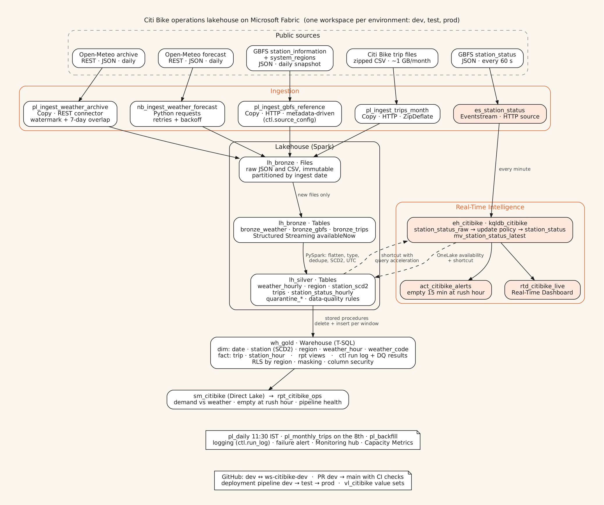

# Architecture

Locked on Fri Oct 23, 2026. Anything here changes only through a new entry in `docs/decisions.md` that Bharat approves (see "Change control" at the end).

## 1. What the project is

An operations lakehouse for New York's Citi Bike system, built entirely in Microsoft Fabric. It answers two business questions:

1. **How does weather drive ride demand?** Daily and hourly trips against temperature, rain and snow, split by member and casual riders.
2. **Which stations run empty at rush hour?** Minutes with zero bikes per station, per hour, on weekday mornings (07:00–10:00) and evenings (16:00–19:00), New York time.

It also has a live view: which stations are empty right now, with an alert when a station stays empty for 15 minutes during rush hour.

## 2. Sources

All three are public. Full details (URLs, parameters, response shapes, limits, licences) are in `docs/sources.md`.

| Source | Kind | How often | Ingested by |
|---|---|---|---|
| Open-Meteo historical weather API | REST, JSON | backfill once, then daily | pipeline Copy activity (REST connector) |
| Open-Meteo forecast API | REST, JSON | daily | notebook with `requests` (retries, backoff) |
| GBFS `station_information` and `system_regions` | REST, JSON | daily snapshot | pipeline Copy activity, metadata-driven |
| GBFS `station_status` | REST, JSON | every 60 seconds | Eventstream HTTP source |
| Citi Bike monthly trip files | HTTP, zipped CSV (about 1 GB a month) | monthly | pipeline Copy activity with zip decompression |

## 3. The picture

The picture is drawn from `docs/img/architecture.dot` (Graphviz). Change the `.dot` file, then rebuild the PNG with `dot -Tpng docs/img/architecture.dot -o docs/img/architecture.png`.

## 4. Layers and where each one lives

Every environment (dev, test, prod) is one Fabric workspace holding the same set of items.

| Layer | Item | What is stored | Format |
|---|---|---|---|
| Landing | `lh_bronze` Files | the untouched API responses and CSVs, one folder per source, partitioned by ingest date | JSON, CSV |
| Bronze | `lh_bronze` Tables | one row per file (JSON sources) or per CSV line (trips), plus lineage columns | Delta |
| Silver | `lh_silver` Tables | typed, flattened, deduplicated, conformed; SCD Type 2 station history; quarantine tables | Delta |
| Gold | `wh_gold` Warehouse | star schema (`dim`, `fact`), reporting views (`rpt`), control tables (`ctl`), data-quality results, security objects (`sec`) | Warehouse tables (Delta underneath) |
| Hot path | `eh_citibike` Eventhouse, KQL database `kqldb_citibike` | live station status, latest-state view, rush-hour emptiness function | KQL tables |
| Serving | `sm_citibike` semantic model (Direct Lake on `wh_gold`), `rpt_citibike_ops` report, `rtd_citibike_live` Real-Time Dashboard | | |

Why a lakehouse for bronze and silver and a warehouse for gold: Spark is the right tool for JSON flattening, SCD2 merges and large CSV parsing; T-SQL is what most analysts and BI tools expect for a star schema, and the Warehouse gives multi-table transactions, stored procedures, and row- and column-level security. ADR-004 records the options that were turned down.

## 5. How a day's run flows

`pl_daily` runs once a day in prod at 11:30 IST, which is 01:00 in New York in winter (02:00 in summer), so the previous New York day is complete when it runs.

1. Log the run start in `ctl.run_log`.
2. In parallel:
   - `pl_ingest_weather_archive`: reads the watermark, asks Open-Meteo for the missing days, lands JSON in `Files/bronze/weather_archive/...`.
   - `nb_ingest_weather_forecast`: calls the forecast API (last 3 days plus the next 2), lands JSON.
   - `pl_ingest_gbfs_reference`: reads `ctl.source_config` and copies `station_information` and `system_regions`.
3. `nb_bronze_load_json`: Spark Structured Streaming with `trigger(availableNow=True)` picks up only the files it has not seen (checkpoint per source) and appends them to bronze tables.
4. Silver notebooks: `nb_silver_weather_hourly` (upsert with source priority), `nb_silver_region`, `nb_silver_station_scd2`, `nb_silver_station_status_hourly` (from the Eventhouse data exposed in OneLake).
5. Gold procedures: dimensions first, then `fact.station_hour`.
6. `dq.usp_run_checks` writes `ctl.dq_result`. An error-severity failure fails the pipeline.
7. Log the run end. Any failure goes to the failure path, which logs the error and sends the alert (route fixed by spike T014).

`pl_monthly_trips` runs on the 8th of each month (the trip file for the previous month is normally published by the 6th): copy the zip, load bronze, build silver trips, load `fact.trip`, run checks. `pl_backfill` runs it once per month for the history.

The live path runs on its own: Eventstream polls `station_status` every 60 seconds and writes to the Eventhouse, an update policy types the rows, a materialized view keeps the latest state per station, and Activator watches the rush-hour function.

## 6. Environments and promotion

| | dev | test | prod |
|---|---|---|---|
| Workspace | `ws-citibike-dev` | `ws-citibike-test` | `ws-citibike-prod` |
| Git | connected, branch `dev`, folder `/fabric` | not connected | not connected |
| How items arrive | built here | deployment pipeline | deployment pipeline |
| Trip history loaded | 2026-04 only (smallest file, 165 MB) | 2026-04 only | 2026-07 to 2026-09, then monthly |
| Streaming | on while building, then stopped | off | on |
| Schedules | off | off | on |

Promotion: work is committed from `ws-citibike-dev` to branch `dev`. A pull request from `dev` to `main` with green checks is the release approval. After the merge, the deployment pipeline `dp-citibike` promotes dev → test (smoke run) → prod. `main` always matches what is in prod. Environment-specific values come from the variable library `vl_citibike` (one value set per stage), never from hard-coded strings. Full map: `docs/environments.md`.

## 7. Engineering standards (summary; detail in `docs/conventions.md`)

- **Idempotent everywhere.** Every load can be re-run for the same window and give the same result: watermarks plus overlap windows, MERGE or delete-and-insert by window, `replaceWhere` on month partitions, deterministic surrogate keys.
- **Raw is immutable.** Landing files are never edited or deleted by a pipeline. Bronze keeps the raw payload as text so a schema change upstream never breaks ingestion.
- **UTC in storage, local time as a column.** New York local time (with daylight saving) is computed once, in Spark, never in SQL or DAX.
- **Every run is logged** (`ctl.run_log`) and **every load is checked** (`ctl.dq_result`), with bad rows sent to quarantine tables instead of being dropped silently.
- **Config lives in data.** Sources in `ctl.source_config`, environment values in `vl_citibike`.
- **Code is tested.** Shared PySpark functions live in one notebook, `nb_lib_common`, which CI imports and unit-tests on every pull request.
- **GA features first.** Two preview features are used on purpose and named as exceptions: the Eventstream HTTP source (ADR-007) and Power BI items in Git (ADR-012).

## 8. Cost

The whole build runs on the 60-day Fabric trial capacity in Bharat's own tenant, with no Azure subscription and no payment method attached. The cost of the build is ₹0 by construction. The trial end date is the hard deadline for everything that needs a live workspace (publish, screenshots, DP-700 practice). What happens after the trial and the pay-as-you-go prices are in `docs/cost-and-capacity.md`.

## 9. Known limits (by design)

- One weather point (Central Park) stands for the whole city.
- Station status history starts the day streaming starts (early November 2026), so it does not overlap the trip history until the November trip file lands in early December.
- The Eventstream with the HTTP source cannot go through Git or the deployment pipeline (a documented preview limitation), so it is created by hand in dev and prod from `docs/runbooks/eventstream.md`.

## 10. Change control

Task chats build exactly what this file, `docs/data-contracts.md` and the task card say. If reality disagrees (a screen differs, a feature is missing, a setting has moved):

- **A small UI difference** (a button renamed, a pane moved) does not change the design. Carry on and note it in the task's Result line.
- **Anything that changes a name, a column, a tool, a layer, a dependency or a cost** stops the task. The chat writes a "Proposed" entry at the end of `docs/decisions.md` (context, options, recommendation), sets the task to `blocked` with `python tools/backlog.py set T### blocked`, and asks Bharat. Work resumes only after he decides.
